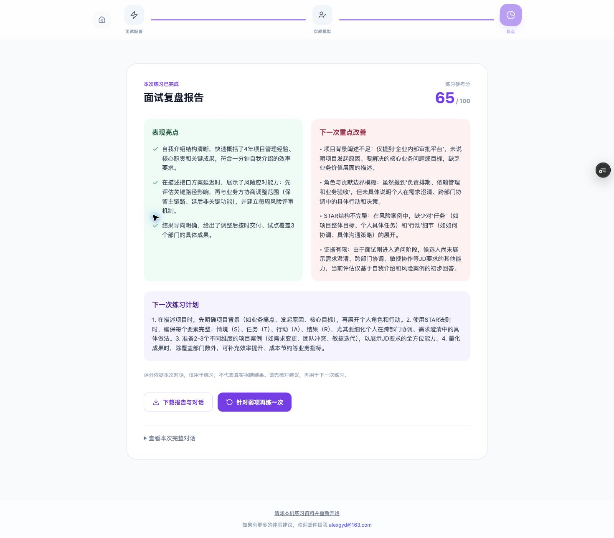

# 0.1.0 试用版验收记录

日期：2026-10-11（Asia/Shanghai）  
基线：`main@cfc00edb461000b8d07fd02051e7c99a98a82b41`  
分支：`codex/private-beta-readiness`  
现有站点：<https://pmalex.vercel.app/>

## 结论

已完成本地试用版改动及回归验证，并于 2026-10-11 发布到现有 Vercel 项目的 Preview 环境。真实 DeepSeek 文字面试、针对性追问和复盘生成已通过线上验收。**尚未发布到正式站点；真实 OCR、TTS 及全流程简历分析仍需专项验收。**

本地验收使用合成测试资料和独立测试服务，测试分数不代表模型评价质量。

## 原版可复现的问题

| 问题 | 用户影响 | 修复 |
| --- | --- | --- |
| 简历附件读取为 base64 后被文本分析服务忽略 | 可以上传但分析不到实际内容 | PDF 本地提取、图片 OCR 后回填可编辑文本 |
| 失败被转换为空结果/0 分报告 | 用户误以为已完成分析 | 异常向上传递，结果做实际运行时校验，报告可原地重试 |
| 开发与线上处理逻辑不同，开发缺少 OCR 路由 | 上线表现与本地不一致 | API 共享处理逻辑，开发覆盖全部路由 |
| 面试上下文截取前 500 字 | 遗漏后续项目经历 | 使用完整输入；对话以结构化消息记录 |
| 按换行解析对话角色 | 多段回答丢失或误识别角色 | 消息数组保留原始多段内容 |
| 没有刷新恢复与报告导出 | 意外刷新丢失练习 | 每个标签页保存草稿、对话与报告；报告和对话可下载 |
| 无依据的 ATS/效果/服务承诺，数据说明与行为不符 | 误解产品能力和数据使用 | 准确说明文字问答、模型处理和练习分；复盘页聚焦下一次行动 |
| 浏览器运行时依赖 Tailwind CDN | 外部资源受阻影响界面 | 构建时编译并打包 CSS |
| 线上付费 API 无试用准入 | 任意访问可能消耗模型费用 | 所有 AI/OCR/TTS 路由校验邀请码，服务端选定模型和输出预算 |

## 已通过

- `npm run check`：类型检查、8 项回归测试、生产构建。
- 错误邀请码拒绝；有效邀请码可进入。
- 全流程：岗位分析 → 文字 PDF 提取 → 简历诊断 → 重写 → 面试 → 报告。
- Chrome 面试直通车：粘贴岗位和简历 → 面试 → 报告。
- 岗位结果、重写草稿、多段面试回答刷新后恢复。
- 回复失败后重试，不重复添加用户回答。
- 首次报告返回无效结构时显示失败；重新生成使用本次已保存的对话。
- 无语音服务配置时，给出朗读不可用提示，文字面试继续。
- 实际导出的两份测试报告在本机下载目录生成，检查包含分数、计划和完整对话。
- 390 px 手机尺寸复盘页：页面宽度和内容宽度均为 390 px，无横向溢出。
- 无真实 API 密钥/个人简历加入代码、测试资料或截图。

## 证据

以下页面使用固定测试返回值：

## 线上预览验收

- 项目：`alexs-projects-3f987acf/pmalex`，现有正式域名保持不变。
- 预览地址：<https://pmalex-8c73mq27z-alexs-projects-3f987acf.vercel.app/>。
- 部署：`dpl_2CnSriZnU6pnTdTorgc9EW74fNyb`，代码提交 `5461ae2`，状态 Ready。
- 已刷新 Vercel CLI 登录，复用现有 Preview 环境的 AI/OCR/TTS 配置；邀请码仅配置在 Preview，未写入仓库。
- 首次线上检查发现原生 ESM 无法解析不带扩展名的模块路径；为 API 的相对导入补充 `.js` 后重新部署，所有接口正常加载。
- Chrome 实测：邀请码进入 → 直通车输入合成岗位和简历 → 真实模型开场 → 多段回答 → 针对审批平台项目追问 → JSON 复盘通过校验并显示完整建议。
- 本次仅回答一轮，模型明确指出证据有限；65 分是该次合成资料的真实练习反馈，不代表完整面试评估或普遍模型质量。
- 修复后本地类型检查、8 项测试和生产构建均通过，GitHub 的 push / PR 检查通过。

以下截图来自真实预览部署，输入资料均为合成测试内容：

## 正式发布仍需完成

1. 对全流程简历分析与重写、图片识别和语音朗读进行真实服务验收。
2. 小范围体验中观察模型延迟、费用、建议质量与简历事实准确性。
3. 核对生产预算和受邀人数，验收后再配置 Production 邀请码并发布。

未实现账号、收费、持久化用户数据、用户级配额和分布式限流；本轮目标是邀请制个人小范围试用。首次试用重点收集：是否能完成练习、追问是否贴合真实项目、报告是否让用户知道下一步怎么改。
