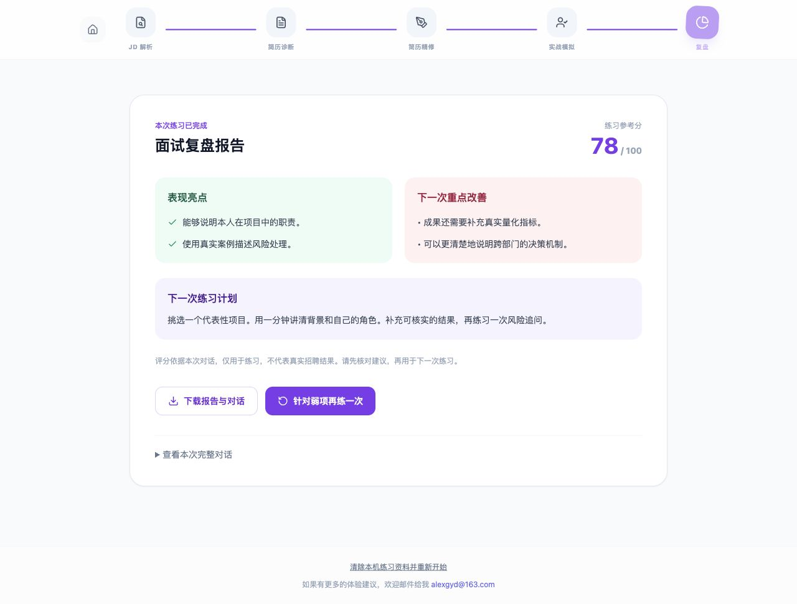
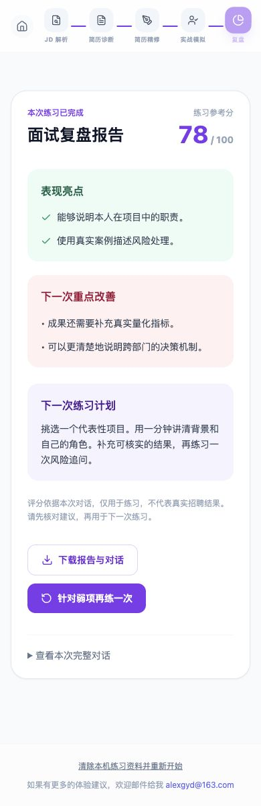

# 0.1.0 试用版验收记录

日期：2026-10-11（Asia/Shanghai）  
基线：`main@cfc00edb461000b8d07fd02051e7c99a98a82b41`  
分支：`codex/private-beta-readiness`  
现有站点：<https://pmalex.vercel.app/>

## 结论

已完成本地试用版改动及回归验证。**尚未发布到正式站点，也尚未完成真实模型/线上配置验收。**

本地验收使用合成测试资料和独立测试服务，测试分数不代表模型评价质量。

## 原版可复现的问题

| 问题 | 用户影响 | 修复 |
| --- | --- | --- |
| 简历附件读取为 base64 后被文本分析服务忽略 | 可以上传但分析不到实际内容 | PDF 本地提取、图片 OCR 后回填可编辑文本 |
| 失败被转换为空结果/0 分报告 | 用户误以为已完成分析 | 异常向上传递，结果做实际运行时校验，报告可原地重试 |
| 开发与线上处理逻辑不同，开发缺少 OCR 路由 | 上线表现与本地不一致 | API 共享处理逻辑，开发覆盖全部路由 |
| 面试上下文截取前 500 字 | 遗漏后续项目经历 | 使用完整输入；对话以结构化消息记录 |
| 按换行解析对话角色 | 多段回答丢失或误识别角色 | 消息数组保留原始多段内容 |
| 没有刷新恢复与报告导出 | 意外刷新丢失练习 | 每个标签页保存草稿、对话与报告；报告和对话可下载 |
| 无依据的 ATS/效果/服务承诺，数据说明与行为不符 | 误解产品能力和数据使用 | 准确说明文字问答、模型处理和练习分；复盘页聚焦下一次行动 |
| 浏览器运行时依赖 Tailwind CDN | 外部资源受阻影响界面 | 构建时编译并打包 CSS |
| 线上付费 API 无试用准入 | 任意访问可能消耗模型费用 | 所有 AI/OCR/TTS 路由校验邀请码，服务端选定模型和输出预算 |

## 已通过

- `npm run check`：类型检查、8 项回归测试、生产构建。
- 错误邀请码拒绝；有效邀请码可进入。
- 全流程：岗位分析 → 文字 PDF 提取 → 简历诊断 → 重写 → 面试 → 报告。
- Chrome 面试直通车：粘贴岗位和简历 → 面试 → 报告。
- 岗位结果、重写草稿、多段面试回答刷新后恢复。
- 回复失败后重试，不重复添加用户回答。
- 首次报告返回无效结构时显示失败；重新生成使用本次已保存的对话。
- 无语音服务配置时，给出朗读不可用提示，文字面试继续。
- 实际导出的两份测试报告在本机下载目录生成，检查包含分数、计划和完整对话。
- 390 px 手机尺寸复盘页：页面宽度和内容宽度均为 390 px，无横向溢出。
- 无真实 API 密钥/个人简历加入代码、测试资料或截图。

## 证据

以下页面使用固定测试返回值：

## 发布仍需完成

1. 重新连接 Vercel。当前 CLI 登录和 Vercel 连接器均要求重新认证，无法读取现有项目的配置或发布。
2. 在现有项目的 Preview 配置/核对文本模型变量与邀请码；可选地配置 OCR、TTS。
3. 预览环境进行真实服务验收：两条路径、PDF/图片识别、有效 JSON、朗读、延迟、费用、简历事实准确性。
4. 核对生产预算和受邀人数，验收后再发布 Production。

未实现账号、收费、持久化用户数据、用户级配额和分布式限流；本轮目标是邀请制个人小范围试用。首次试用重点收集：是否能完成练习、追问是否贴合真实项目、报告是否让用户知道下一步怎么改。
